<a href="https://irahulsoni.com"><b>irahulsoni.com</b></a> &nbsp;·&nbsp;
<a href="https://www.linkedin.com/in/irahulsoni"><b>LinkedIn</b></a> &nbsp;·&nbsp;
<a href="https://github.com/emberyard"><b>emberyard</b></a> &nbsp;·&nbsp;
<a href="https://emberyard.github.io/idx-site/"><b>IDX</b></a>

## Now: IDX

A Mac cockpit for people who run **Claude Code** and **Gemini CLI** across many projects. Every session is a chat first, the terminal is one click away, and nothing is lost when the app restarts. It runs over your own CLIs and accounts. Signed, notarized, auto-updating. Closed beta.

<a href="https://emberyard.github.io/idx-site/">
<picture>
<source media="(prefers-color-scheme: dark)" srcset="https://raw.githubusercontent.com/emberyard/idx-site/main/public/img/hero-dark-1280.webp">

</picture>
</a>

Screenshot from the IDX site. Demo data only.

<b>What's in it</b>

- Chat over Claude Code and Gemini CLI; Antigravity as a terminal tab
- One window per project, several chats side by side, with an approvals rail
- A "Needs you" sidebar so waiting sessions never get lost
- Rewind to an earlier prompt, or send now
- A details panel: sub-agents, long output, changes, plan, to-do list, files (Markdown, images, PDF, CSV, JSON)
- Accounts kept in separate folders, switched by hand, never automatically
- Smart approvals, trust levels, a Mac permissions center, 4K-first layout

## Shipping rhythm

Yantra came first: a mission-control app for directing agents across projects, 42 public releases, now superseded. IDX is the rebuild with what that taught me. Its public repos run the same discipline as the private ones: a ticket key on every commit, squash-merge only, a changelog checked in CI, and an automated audit that blocks leaks before anything is published.

## How I work

## Research and other builds

Most of it is private, so here is what each one is rather than a link.

| | What it is |
|---|---|
| **forge** | A sourced survey of 358 agent-tooling repos (28 Aug 2026). Every claim is labelled measured, verified, derived or assumed. The finding: the fleet was over-tooled, not under-tooled. |
| **assay** | An audit, rebuild and verify pipeline for business websites. It separates findings an owner can check for themselves from signals that are never sent. |
| **outreach console** | One console over every prospect and channel, with a database-level guard against double contact. |
| **ledger** | An append-only event store and dashboard. Every number is tagged measured, derived or unverified, and agent work is never counted as mine. |
| **byrahul.com** | A studio site I built in six languages. |

## Where the work has been

I designed the document AI that replaced a company's legacy document software, from first version to handover. I built Dubmate, an AI video-dubbing product: it worked and never found paying customers, and it grew into my video research library. Before that, almost seven years of end-to-end software for startups and enterprises.

## Stack

Numbers measured from the GitHub API on 19 Oct 2026 and the public IDX README. Private repos are described, not shown.
